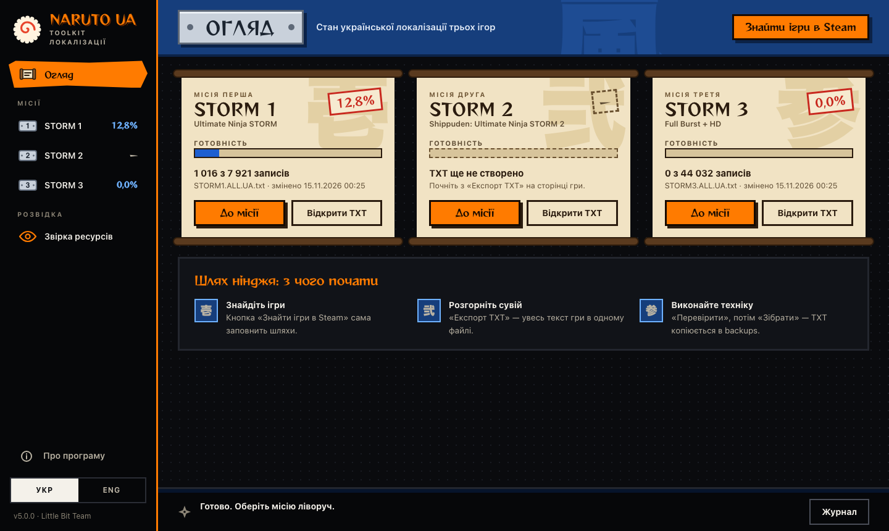

# NARUTO UA Toolkit 5.0

*English: [README.md](README.md)* · [Завантажити останній реліз](https://github.com/LittleBitUA/NARUTO-Ultimate-Ninja-STORM-Localization-Tool/releases/latest)

Інструмент української локалізації NARUTO: Ultimate Ninja STORM 1, STORM 2 та STORM 3 (Full Burst + HD):
тексти, текстури й шрифти.



## Запуск

1. Windows, Python 3.10 або новіший.
2. Один раз запустіть `INSTALL_DEPENDENCIES.bat` (Pillow, fonttools).
3. Запускайте `START_WINDOWS.bat`. Програма відкривається у власному вікні, яке малює Microsoft Edge (він є у Windows 10 і 11); якщо ні Edge, ні Chrome немає — відкриється вкладкою у браузері. Програма працює без інтернету і спілкується лише сама з собою на `127.0.0.1`.

Шляхи з попередніх версій підхоплюються автоматично (той самий файл налаштувань у `%LOCALAPPDATA%\NarutoSTORM1UATool`).

Мова інтерфейсу — українська або англійська — обирається за мовою Windows; перемикач є внизу бічної панелі.

## Робота з текстом

Для кожної гри один TXT у робочій папці (`STORM1.ALL.UA.txt`, `STORM2.ALL.UA.txt`, `STORM3.ALL.UA.txt`) і маніфест поруч.

```text
### 12 — message\003_xxx\S2.txt · рядок 4 · EN: Hello!
Привіт!

###
```

- Редагуйте тільки текст між заголовком `### N — …` і завершальним `###`.
- Порожній переклад означає «лишити англійський оригінал».
- Рядок, що починається з `#` або `\`, екрануйте як `\#` або `\\`.
- Заголовки й порядок записів не змінюйте; маніфест не редагуйте.

Кнопки: **Експорт TXT** (повторний експорт переносить наявні переклади й робить резервну копію),
**Перевірити** (нічого не записує в Build), **Зібрати**.

| Гра | Що робить «Зібрати» |
| --- | --- |
| STORM 1 | збирає XFBIN у Build і встановлює в гру з резервними копіями |
| STORM 2 | збирає тестовий XFBIN + ZIP у Build, у гру не встановлює |
| STORM 3 | збирає три XFBIN (Full Burst, HD WIN32, HD WIN64), встановлює, є відкат |

### Автовиправлення роздільника

Перед перевіркою та пакуванням програма сама відновлює порожній рядок перед `###`, якщо його видалили
(те саме, що заміна `([^\r\n])\r?\n(?=###(?:\r?\n|$))` → `\1\r\n\r\n`). Якщо файл змінено, попередня
версія лишається поруч як `<назва>.before_autofix.bak`, а кількість виправлень пишеться в журнал.

### Готовність

Відсоток для кожної гри видно на сторінці «Огляд», у бічній панелі та в шапці сторінки гри. Рахуються
записи TXT, де є переклад, відмінний від англійського оригіналу.

### Зручності

- **«Знайти ігри в Steam»** на «Огляді» знаходить встановлені ігри й заповнює шляхи.
- **«Перевірити теги»** показує одразу всі записи, де теги `<...>` відрізняються від оригіналу.
- TXT **автоматично копіюється** в `backups` перед кожним збиранням (10 останніх копій); є й кнопка «Резервна копія TXT».
- Права кнопка миші в полі шляху: вставити, копіювати, очистити, відкрити папку.
- Операцію, що триває, можна перервати кнопкою **«Зупинити»** в рядку стану; уже записані файли лишаються.
- Шлях до вихідного файлу чи папки, якого не існує, підсвічується червоним.
- Журнал можна скопіювати або очистити; програма пам'ятає розмір вікна й останню сторінку.

## Текстури

Експорт PNG не перезаписує вже відредаговані файли. Редагуйте тільки PNG, не змінюйте розмір і
альфа-канал, не чіпайте `textures_manifest.json`. «Зібрати змінені PNG» складає XFBIN у `Build\data_win32`.
Підтримано BC1/DXT1 і BC3/DXT5 без mip-рівнів.

## Шрифти

Літери беруться або з вбудованого шрифту **ReggaeC UA**, або з вашого TTF / OTF — це вибирається у вкладці «Шрифт» кожної гри. Для STORM 1 можна вказати, **які саме символи створити**: вписати будь-який набір або додати абетку, тире, лапки та інші знаки одним натисканням.

- **STORM 1** — українські літери додаються в нові рядки атласу, оригінальні 3683 гліфи не змінюються.
  Кожна нова комірка має 4 px порожнього поля з усіх боків. Після пакування атлас зчитується назад:
  якщо поруч із коміркою є сторонні пікселі, шрифт не записується. Прев’ю «Як це виглядає у грі»
  збирається з уже запакованого атласу. Скопійовані з гри «р», «у» та тире зберігають власне положення
  оригінальної літери, тож мала «р» не виглядає як велика.
- **STORM 2** — літери у вільних рядках атласу 512×512; окремо є ремонт раніше зібраного шрифту.
- **STORM 3** — 66 літер, атлас 512×256 → 512×512, одразу з установленням і можливістю відкату.

Усі шрифти та підміна тексту в HD-редакції STORM 3 потребують перевірки в самій грі.

## Файли

| Файл | Зміст |
| --- | --- |
| `natool.py` | програма: налаштування, опис сторінок, локальний сервер, вікно |
| `web/` | сам інтерфейс: `index.html`, `app.css`, `app.js` і шрифт ReggaeC UA |
| `jobs.py` | запуск кожної операції окремим процесом |
| `i18n.py` | мова інтерфейсу та повідомлень |
| `txtfmt.py` | формат TXT, автовиправлення, підрахунок готовності |
| `storm1_text.py`, `storm2_text.py`, `storm3_text.py` | тексти: експорт, збирання, установлення |
| `storm1_font.py`, `storm2_font.py`, `storm3_font.py` | шрифти |
| `textures.py` | текстури PNG ⇄ XFBIN |
| `audit.py`, `PATCH_REFERENCE_SCOPE.json` | звіти лише на читання |
| `xfbin.py` | читання контейнера NUCC/XFBIN |
| `steam.py` | пошук встановлених ігор у бібліотеках Steam |

## Тести

```text
py -3 -m pip install pytest
py -3 -m pytest tests
```

Частина тестів працює на синтетичних файлах. Тести на справжніх ресурсах пропускаються, доки не задано
змінні середовища з власними файлами: `STORM1_FONT_TEST_FILE`, `STORM1_FONT_TTF`,
`STORM1_TEXTURE_TEST_DIR`, `STORM2_TEST_FILE`, `STORM2_FONT_TEST_SOURCE` (інші — у самих тестах).

## Автор

Dmytro Bidlov («Little Bit» Team) · Made in Ukraine · [t.me/LittleBitUA](https://t.me/LittleBitUA)

## Ліцензія

[MIT](LICENSE).
